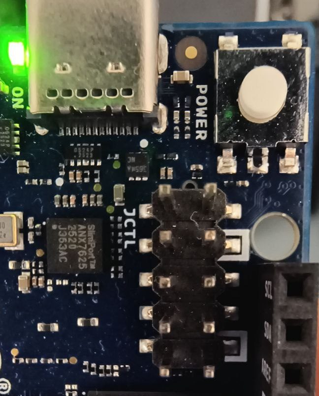

# Arduino UNO Q toolkit

Build your own firmware for both of the Arduino UNO Q's processors, and get the
factory image back when you want it.

The board has two. The Qualcomm QRB2210 (the MPU) runs Linux from eMMC, and the
STM32U585 (the MCU) runs its own firmware. The MCU has no external SWD pins, so
the only thing that can program it is the Linux side of the same board. That one
fact shapes everything else here.

There is no SD card slot for the MPU, so there is no "take the card out and fix
it on your laptop". The only way in is the SoC's Emergency Download mode (EDL),
which lives in the chip's mask ROM. That cuts both ways: it is the only way to
install anything, and it is also why the board is very hard to brick
permanently. A bad image means the board will not boot until you flash it
again, not that the board is gone.

## What you end up with

A Linux image of your own on the MPU, reachable over the single USB-C cable as
both a network link and a login shell, able to program the MCU. Firmware of your
own on the MCU, under MCUboot, driving the 13x8 LED matrix. Optionally the Exein
Pulsar runtime security agent, with the kernel configured so its eBPF LSM path
works instead of silently falling back to kprobes.

Arduino's Debian image is the right place to start and the wrong place to ship
from: you cannot pin what is in it, drop what you do not need, or turn on a
kernel option. Past the prototype you build your own, and then you need the
parts here.

## What is here

- `meta-unoq`, a Yocto layer: the USB gadget and its login console, OpenOCD with
  the board's SWD pin map and `unoq-flash-mcu`, a systemd unit for Pulsar, and
  the kernel fragments all of it needs;
- `zephyr/led-matrix`, an application and a west manifest, built with `sysbuild`
  so one build produces MCUboot and the signed application together;
- a guide to EDL recovery and flashing, below.

## What you need

- A **USB-C cable that carries data**. See the troubleshooting section; this
  catches more people than anything else here.
- A **jumper shunt** (2.54 mm) or a female-to-female jumper wire.
- A Linux host. The tools exist for macOS and Windows too, but the commands
  below are Linux.
- About 2.5 GB of disk for the factory image.

Optional but worth having:

- A **1.8 V** USB-UART adapter, if you plan to build your own images. Explained
  under "Getting a shell".

## Get the tools

Both come from Arduino and are the same binaries their official flasher uses.

- **Arduino Flasher CLI**: https://github.com/arduino/arduino-flasher-cli/releases
  Downloads and flashes Arduino's Debian images.
- **qdl**: https://github.com/arduino/qdl-packing/releases
  The Qualcomm download tool. Needed only if you flash an image that is not
  Arduino's, for example one you built yourself. The Flasher CLI embeds its own
  copy, so you do not need this for recovery alone.

```sh
tar xzf arduino-flasher-cli-*-linux-amd64.tar.gz
tar xzf qdl_*_Linux_64bit.tar.gz
./arduino-flasher-cli version
./qdl --version
```

## Keep a copy of the factory image before you need it

This is the single most useful thing you can do before experimenting.

```sh
./arduino-flasher-cli list
./arduino-flasher-cli download unoq --dest-dir ~/arduino-uno-q-toolkit
```

`list` shows every published image, not only the newest, and `download
--version <v>` fetches any of them. The image is roughly 2.2 GB and arrives as
a `.tar.zst`.

Record its checksum so a truncated copy is obvious later:

```sh
sha256sum ~/arduino-uno-q-toolkit/arduino-unoq-debian-image-*.tar.zst > ~/arduino-uno-q-toolkit/SHA256
```

Keep it on real disk, not in `/tmp`. On most distributions `/tmp` is a RAM
filesystem, so a 2.2 GB download there costs you memory and disappears at the
next reboot, which is exactly when you are likely to want it.

The Flasher CLI can install from a local file:

```sh
./arduino-flasher-cli flash ~/arduino-uno-q-toolkit/arduino-unoq-debian-image-20260528-558.tar.zst
```

Prefer that over `flash unoq`, which downloads the image each time. A board
that will not boot is the worst moment to discover your internet is down.

## Host setup, once

`qdl` and `adb` both need raw USB access.

```sh
# EDL mode (flashing)
echo 'SUBSYSTEM=="usb", ATTR{idVendor}=="05c6", ATTR{idProduct}=="9008", MODE="0660", TAG+="uaccess"' \
  | sudo tee /etc/udev/rules.d/50-qdl.rules

# The board running Arduino's image (adb)
echo 'SUBSYSTEM=="usb", ATTR{idVendor}=="2341", ATTR{idProduct}=="0078", MODE="0660", TAG+="uaccess"' \
  | sudo tee /etc/udev/rules.d/51-arduino-unoq.rules

sudo udevadm control --reload-rules
sudo udevadm trigger
```

`MODE="0660"` with `TAG+="uaccess"` grants access to the user logged in at the
machine, rather than to everyone as `MODE="0666"` would.

Replug the board after adding a rule. Rules apply when a device appears, not
retroactively.

ModemManager will grab the board in EDL, because it looks like a modem:

```sh
sudo systemctl stop ModemManager
```

## Entering EDL

EDL is entered by holding the `USB_BOOT` strap low while the board powers on.
The strap is sampled once at power-on, so the board must be fully unpowered
first. Unplugging USB-C is enough.

The JCTL header is a 2x5 next to the USB-C connector, silkscreened `JCTL`:



| | left | right |
| --- | --- | --- |
| row 1 | `VBUS_DISABLE` | `+1V8 OUT` |
| row 2 | `PMIC_RESET` | `GND` |
| row 3 | `SOC_SE4_RX` | `VOL_UP` |
| row 4 | `SOC_SE4_TX` | `VOL_DOWN` |
| row 5 | `USB_BOOT` | `GND` |

`USB_BOOT` and a `GND` sit opposite each other in row 5, so a jumper shunt
placed **across that end row** is all that is needed.

### Find the row by the silkscreen, then confirm it

**The two ground pins are marked.** Each carries a white square in the
silkscreen, and no other pin on the header does. That is the quickest way to
orient yourself, and it is printed on the board in your hand rather than on a
photograph of someone else's.

There are exactly two of those marks, at rows 2 and 5, and only row 5 is at an
end of the header. So:

- the end row that has a marked pin is **row 5**: that is the one to jumper
- the end row with no marked pin is **row 1**: leave it alone

This matters because published pictures disagree about whether the header sits
at the upper left or the upper right, and your board can be the other way round
from whatever diagram you are looking at. Orientation taken from a photograph is
how people short the wrong pins.

If the silkscreen is hard to read under a heatsink or poor light, confirm it
electrically: with the board unpowered, use a multimeter in continuity mode from
a known ground (the USB-C shell, or a mounting hole) to the two pins at **each**
end of the header. The end row with exactly one ground pin is row 5; the end row
with none is row 1.

### Three ways to damage the board

- **The other end row.** A shunt there connects `VBUS_DISABLE` to `+1V8 OUT`.
- **Along a column instead of across a row.** `+1V8 OUT` (row 1) sits directly
  above `GND` (row 2), so a shunt down that column shorts the 1.8 V regulator
  to ground.
- **A 3.3 V or 5 V UART adapter** on `SOC_SE4_TX`/`RX`. The entire header is
  1.8 V. `+1V8 OUT` is a reference for a level shifter, never a supply.

### Sequence

1. Disconnect USB-C so the board is fully unpowered.
2. Fit the shunt across row 5 (`USB_BOOT` to `GND`).
3. Connect USB-C with the shunt still in place.
4. Confirm: `lsusb | grep 05c6` should show `05c6:9008`, Qualcomm HS-USB
   QDLoader. Running normally the board is `2341:0078` instead.
5. Flash.
6. **Remove the shunt** and power-cycle. Left in, the board re-enters EDL on
   every boot and never starts what you installed.

### Rehearse it first

Do steps 1 to 4, then 6, with no flashing in between. That proves the jumper
position, your udev rule and that the host can see the board, while the system
on it is still working. It is a much better moment to discover a problem.

## Flashing your own image

A build system that targets this board produces a `qcomflash` package: a
directory containing `prog_firehose_ddr.elf`, `rawprogram*.xml`, `patch*.xml`
and the partition images.

```sh
cd <the unpacked qcomflash directory>
qdl --allow-missing --storage emmc prog_firehose_ddr.elf rawprogram0.xml patch0.xml
```

`--storage emmc` matters: eMMC is the board's only boot storage. If several
boards are attached, `--serial=<serial>` picks one.

A successful run ends with `partition 0 is now bootable`.

## Building your own Linux image with Yocto

Any Yocto build for this board needs the Qualcomm BSP layers (`meta-qcom` and
`meta-qcom-arduino`, which carries the `uno-q` machine and the
`qrb2210-arduino-imola` device tree) on top of `openembedded-core`. That part is
upstream and documented. What is not documented is everything after that: how
to reach the board at all, how to program its microcontroller, and which kernel
symbols the Exein stack needs that nothing else will set for you. That is what
`meta-unoq` is for.

It provides:

| | |
|---|---|
| `packagegroup-unoq-base` | the USB gadget and its console, OpenOCD with the SWD pin map, `unoq-flash-mcu` |
| `packagegroup-unoq-exein` | Pulsar plus a systemd unit to run it |
| kernel fragments | the gadget symbols, and Pulsar's requirements that `meta-exein` cannot deliver here |
| a configuration check | warns at `do_configure` when a fragment was silently ignored |

### The layers

This is the set a `core-image-minimal` for this board actually needs, which is
more than the four layers people usually expect. `meta-unoq` lives in a
subdirectory of this repository, so point at that path and not the repository
root.

```
BBLAYERS ?= " \
    /path/to/arduino-uno-q-toolkit/meta-unoq \
    /path/to/meta-arm/meta-arm \
    /path/to/meta-arm/meta-arm-toolchain \
    /path/to/meta-exein \
    /path/to/meta-lts-mixins \
    /path/to/meta-openembedded/meta-filesystems \
    /path/to/meta-openembedded/meta-networking \
    /path/to/meta-openembedded/meta-oe \
    /path/to/meta-openembedded/meta-python \
    /path/to/meta-qcom \
    /path/to/meta-qcom-arduino \
    /path/to/openembedded-core/meta"
```

`meta-oe` is where OpenOCD and libgpiod come from, and it drags in
`meta-python`, `meta-networking` and `meta-filesystems`. `meta-lts-mixins`
supplies the linux-firmware that `meta-qcom` wants. Drop `meta-exein` if you do
not want the Exein stack.

### The configuration

Four settings, and three of them are not optional.

```
MACHINE = "uno-q"

# Every unit this layer ships is a systemd unit. On the default init the files
# install and nothing starts: no gadget, no console on it, no Pulsar, and no
# error anywhere to say why. This is the one to get wrong if you want to lose an
# afternoon.
INIT_MANAGER = "systemd"

# meta-qcom's firmware carries flagged licences. Without this those recipes are
# skipped and the build fails on missing firmware.
LICENSE_FLAGS_ACCEPTED = "synaptics-killswitch commercial"

# OpenOCD's linuxgpiod adapter wants libgpiod v1 and meta-oe defaults to v2, so
# without this the OpenOCD build fails in configure.
PREFERRED_VERSION_libgpiod = "1.6.5"
```

Then install it:

```
CORE_IMAGE_EXTRA_INSTALL += "packagegroup-unoq-base"
```

That brings the USB gadget, the login console on it, and the MCU tooling. It
pulls in OpenOCD, and the layer's `bbappend` enables the `linuxgpiod`
adapter driver. meta-oe builds OpenOCD with `sysfsgpio` and `remote-bitbang`
only, and neither is usable here: `sysfsgpio` is deprecated upstream and numbers
pins globally, so a number changes when a gpiochip's base moves, while
`remote-bitbang` wants a server at the other end.

### Reaching the board over the USB-C cable

The board has no ethernet port and no console connector. Out of the box an image
you build yourself offers nothing a host can connect to, and the only other way
in is the 1.8 V serial header described further up, which needs a level-correct
adapter and some wiring.

`packagegroup-unoq-base` fixes that with a CDC-ECM + CDC-ACM gadget on the
USB-C socket the board is already powered by: an address and a login shell over
one cable. The board takes `192.168.7.2/24` on `usb0`; give the host
`192.168.7.1/24` on its end and you have both a network and a serial console.

A static address rather than DHCP, deliberately: there is usually no server on
the host, and a link that never comes up is harder to diagnose than one with a
known address.

Two things in here were expensive to learn and are worth repeating if you write
anything similar.

The gadget cannot be created from a hook inside `systemd-networkd`. That unit
ships `ProtectKernelModules=yes`, so no process in it can load a module, and
`/sys/kernel/config/usb_gadget` is created by `libcomposite`, not by configfs. A
dashed `ExecStartPre=-` then throws the failure away. The board stayed dark on
USB across two builds that way while the script itself was correct and bound the
controller first try by hand. Hence a unit of its own, with no sandboxing.

And every command in the script is a BusyBox applet with BusyBox semantics. The
first version used `head -1`, a GNU extension BusyBox refuses outright, so it
exited non-zero on every boot since the first. BusyBox also has no `install`, no
`parted`, no `timeout`, and its `od` takes none of `-A`, `-t` or `-N`.

### The Exein stack, and a trap worth knowing about

```
CORE_IMAGE_EXTRA_INSTALL += "packagegroup-unoq-exein"
```

That needs [meta-exein](https://github.com/exein-io/meta-exein) in your
`bblayers.conf`. It installs Pulsar and, importantly, a systemd unit to run it:
meta-exein ships the binaries and no unit, so on a systemd image the agent is
present and never starts, and nothing fails to tell you.

The trap is in the kernel configuration. meta-exein lists Pulsar's 21 required
symbols in `btf.cfg` and wires it in through `btf.scc`. A `.scc` is a
`kernel-yocto` construct, and `linux-qcom` is not a `kernel-yocto` recipe: it has
no `.kernel-meta`, so the `.scc` is fetched into the kernel work directory and
then ignored entirely. None of `btf.cfg` is merged. Nothing warns, the build is
green, and Pulsar starts.

What you lose is the eBPF LSM path. The `meta-qcom` defconfig happens to supply
17 of those 21 symbols, so Pulsar looks healthy, logs threats, and quietly runs
on kprobes instead. The symptom, at debug log level only, is:

```
WARN bpf_feature_autodetect::lsm] LSM not supported: Load failed
        Unknown BTF type `bpf_lsm_socket_bind`
```

Pulsar's probe loads exactly one BPF LSM program, on the `socket_bind` hook, and
every socket LSM hook sits behind `CONFIG_SECURITY_NETWORK`. With that unset the
kernel BTF held 216 `bpf_lsm_*` symbols and not a single `bpf_lsm_socket*`, so
the one hook it tests was in the one family compiled out. The whole enforcement
path was lost to a single unset bool.

This layer ships those symbols as a plain `.cfg`, which `linux-qcom` does merge.
Setting them took the kernel to 816 `bpf_lsm_*` symbols, 51 of them
`bpf_lsm_socket*`, and the warning went away.

### When a kernel fragment is ignored

A fragment is a request, not a setting. A symbol that another option `select`s
follows that option instead, and is dropped in silence. Asking for
`CONFIG_USB_LIBCOMPOSITE=y` does nothing on its own, because it has no prompt:
`USB_CONFIGFS` is the option that selects it.

That cost two builds and a board that presented nothing on USB, so this layer
checks. At `do_configure` it compares what the fragments asked for against what
Kconfig produced, and warns per symbol:

```
WARNING: meta-unoq kernel configuration: asked for CONFIG_USB_LIBCOMPOSITE=y,
but the kernel was configured with CONFIG_USB_LIBCOMPOSITE=m. A symbol that
another option selects cannot be set from a fragment; set the option that
selects it instead.
```

Worth reading your build log for. It appears long before anything is flashed.
`UNOQ_EXPECTED_CONFIG` is the list it checks and `UNOQ_KERNEL_FRAGMENTS` selects
which fragments are applied, so drop a name from the latter if you do not want
the Exein symbols.

### Programming the MCU from the board itself

The STM32U585's debug lines are GPIOs of the QRB2210. Linux bitbangs SWD over
them, which means no probe to plug in and no probe to lose, and also that the
board is the only thing that can do it.

Put two files where the script looks for them, both from the same build:

```
/lib/firmware/mcuboot.bin        the bootloader, at the start of flash
/lib/firmware/zephyr.signed.bin  the application, in MCUboot's slot 0
```

Then, on the board:

```sh
unoq-flash-mcu            # bootloader and application
unoq-flash-mcu --app-only # just the application, once the bootloader is there
unoq-flash-mcu --probe    # report what the MCU is and where it is executing
```

It runs unprivileged: the SWD pins are reached through `/dev/gpiochip*`, so
membership of the group owning those nodes is enough.

Both images have to come from the same build. The bootloader embeds the public
key the application was signed with, and the two agree on where slot 0 begins.
A signed application alone leaves a board that does nothing; a bootloader alone
leaves one that finds no valid image. Neither says so out loud.

Note that Arduino's own layout is different: their script writes a Zephyr core
at its own addresses and a *sketch* at `0x080F0000`. An MCUboot image from
`sysbuild` links into slot 0 at `0x08010000` instead, so their addresses do not
apply to it. If you are unsure which you have, an MCUboot image begins with the
magic number `0x96f3b83d`, and `unoq-flash-mcu` refuses anything that does not.

The MCU's flash is independent of the eMMC, so the microcontroller keeps its
firmware across a Linux reflash. You can program it from one image and then
install another.

## Add-on: containers at build time, and growing the rootfs

Two things most people want next are not in this layer, because they are not
specific to this board. They are in
[meta-container-deploy](https://github.com/technosec-dev/meta-container-deploy),
also open source:

- **Containers baked into the image at build time**, with podman and Quadlet
  units, so a device boots with its workloads already present and pulls nothing
  on first start.
- **`rootfs-expand`**, which grows the root filesystem to fill its partition on
  first boot. Useful here because a built image is a few hundred megabytes while
  the eMMC is tens of gigabytes, and the flashing step sizes the partition to
  the disk but leaves the filesystem as built.

Add it the same way:

```
BBLAYERS += "/path/to/meta-container-deploy"
```

## The Zephyr side

`zephyr/` holds a complete application for the board's 13x8 LED matrix and the
west manifest to build it, so the MCU half needs no more than the Yocto half
does: a checkout and one command.

```
zephyr/west.yml                                 pins Zephyr v4.5.0-rc1
zephyr/led-matrix/CMakeLists.txt
zephyr/led-matrix/prj.conf                      display + console
zephyr/led-matrix/sysbuild.conf                 MCUboot alongside the app
zephyr/led-matrix/boards/arduino_uno_q.overlay  console on lpuart1
zephyr/led-matrix/src/main.c
```

### Build it

```sh
pip install west
west init -m https://github.com/technosec-dev/arduino-uno-q-toolkit \
    --mf zephyr/west.yml unoq-zephyr
cd unoq-zephyr
west update
west zephyr-export
pip install -r zephyr/scripts/requirements.txt

west build -b arduino_uno_q --sysbuild \
    arduino-uno-q-toolkit/zephyr/led-matrix
```

You also need a Zephyr SDK for `arm-zephyr-eabi`; Zephyr's own getting-started
page covers installing it.

`--sysbuild` is not optional here. It is what produces the bootloader as well as
the application, and the two have to come from the same build for the reasons in
the flashing section above. The images land at

```
build/mcuboot/zephyr/zephyr.bin
build/led-matrix/zephyr/zephyr.signed.bin
```

which are the two files `unoq-flash-mcu` wants.

### Why the manifest pins a release candidate

`v4.5.0-rc1` is the first Zephyr tag whose `arduino_uno_q` devicetree describes
the matrix. The board itself landed earlier and is in `v4.4.2`, but that tag has
no `charlieplex-led-matrix` node and no `zephyr,display`, so this application
does not build against it. There is no stable tag with the matrix at the time of
writing, so the choice is a release candidate or nothing.

### What the application does, and what is worth copying from it

It sweeps a column across the panel and then draws a bitmap, on a loop. The
sweep is there as a check rather than for decoration: a wrong row stride walks
the column diagonally and a wrong bit order sweeps each group of eight
backwards, and both are obvious on the panel while neither produces an error
anywhere.

The matrix is a display, not 104 addressable LEDs. The board's devicetree sets
`zephyr,display = &led_matrix`, the driver scans the panel from TIM17, and the
application writes a framebuffer through the display API. Two details of that
framebuffer are easy to get wrong and silent when you do:

- The driver offers `PIXEL_FORMAT_MONO01` and nothing else, so one bit per
  pixel, set meaning lit. The `grayscale-bits = <3>` in the devicetree is the
  driver's internal duty resolution, which `display_set_brightness()` reaches
  and a write does not.
- Its write path reads row `n` at `buf + n * (pitch / 8)` and takes a column as
  `(byte >> (col % 8)) & 1`. So `pitch` counts PIXELS and must be a whole number
  of bytes, and the bits run least-significant-first across each byte, not
  MSB-first as display code often assumes. Thirteen columns therefore means a
  pitch of 16 and two bytes per row.

The board's devicetree chooses no console at all, which is why the overlay
points one at `lpuart1`. That is the internal link to the Qualcomm side, so the
boot banner is readable from Linux on `/dev/ttyHS1`. Without it a perfectly good
build is indistinguishable from a dead one.

## Getting a shell

### On Arduino's image

The factory image runs `adbd`, so use adb:

```sh
adb devices
adb shell
```

The CDC-ACM serial port the board also exposes is a channel for Arduino's
tooling, not a login console, so do not expect a prompt from `minicom` on it.

If `adb devices` is empty while `lsusb` shows `2341:0078`, it is the udev rule.
Add it, replug, then `adb kill-server` once and try again.

### On your own image

**This is where most custom images go wrong.** A minimal Linux image has no
reason to present anything over USB, and this board has no ethernet port, so a
freshly flashed custom image can boot perfectly and still look completely dead
from the host. Nothing in `lsusb`, no serial port, no network.

Plan one of these before you flash:

- **A USB gadget.** The board has one UDC, `4e00000.usb`, and Arduino drive it
  through configfs: their gadget is `g1`, bound to that controller. A composite
  gadget with CDC-ECM (an IP link) plus CDC-ACM (a login console on `ttyGS0`)
  gives you two ways in over the cable that already powers the board. The
  kernel ships `libcomposite`, `usb_f_ecm`, `usb_f_acm` and `usb_f_rndis`;
  there is no legacy `g_ether`, so `modprobe g_ether` will silently do nothing.
- **The serial console** on `SOC_SE4_TX` and `SOC_SE4_RX`, JCTL rows 3 and 4,
  115200 baud. This is the only way to watch a boot that fails before userspace,
  and the only one that works when the image is broken. It needs a **1.8 V**
  adapter.
- **WiFi**, if you configure credentials into the image.

If you build images for this board regularly, get the 1.8 V adapter. Without a
console, an image that halts in the bootloader and an image that boots fine but
presents no USB look exactly the same from the host, and you will spend flash
cycles guessing between them.

## Troubleshooting

**Nothing appears in `lsusb` at all, but the board's power LED is on.**
Almost always a charge-only USB-C cable. Such a cable carries power but not
data, so the board powers up and blinks happily while the host sees nothing.
Try another cable before suspecting anything else, and prefer a port directly
on the machine over one behind a hub.

**The board keeps disconnecting and reconnecting every few seconds.**
Check whether a tool on the host is probing it. Starting and stopping the adb
server, or other software that opens USB devices to interrogate them, causes
re-enumeration that looks like the board resetting. Confirm with `uptime` over
adb before concluding the board is unstable.

**`qdl` says it cannot open the USB device.**
The udev rule is missing or was added after the board enumerated. Add it,
reload rules, and replug.

**The board boots to EDL (`05c6:9008`) with no jumper fitted.**
The ROM found nothing bootable and fell back. Flash a known-good image.

**You flashed your own image and the board shows nothing.**
See "On your own image" above. Flash the factory image to confirm the board and
your procedure are fine; if the factory image comes up as `2341:0078`, the
hardware and your flashing are good and the problem is in your image.

## If all else fails

Enter EDL and flash the factory image. EDL is in ROM and does not depend on
anything stored on eMMC, so no image you write can take that path away.

## Built by TechnoSec

Open source, usable with plain Yocto. Issues and pull requests welcome. See also
[meta-container-deploy](https://github.com/technosec-dev/meta-container-deploy)
for containers at build time and `rootfs-expand`.

Doing this by hand teaches you the board. Try
[EmbedForge](https://embedforge.io), the enterprise-grade build platform for
device makers. Connect its MCP, describe the device to the AI agent you already
use, and it builds it.

In public preview, access by invitation, so ask if you are building a product on
this.
